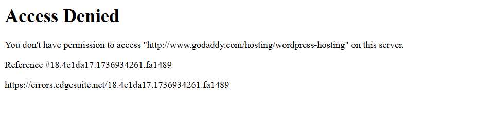
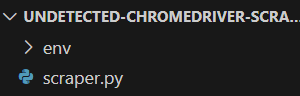
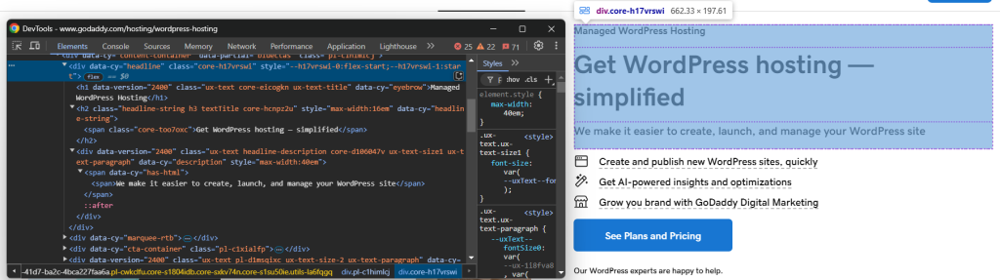
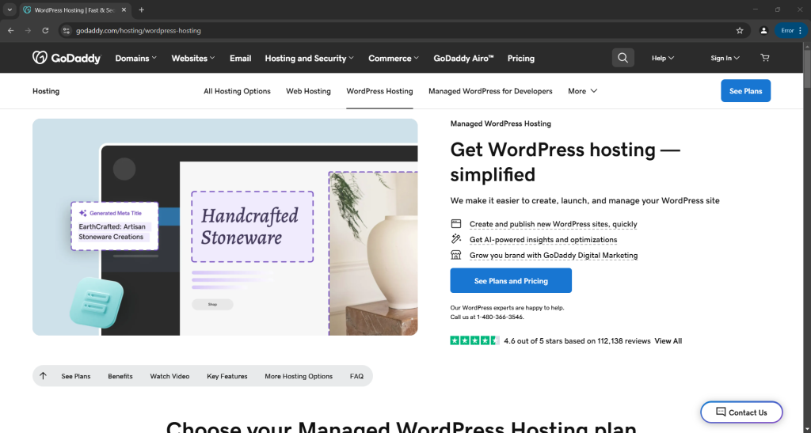
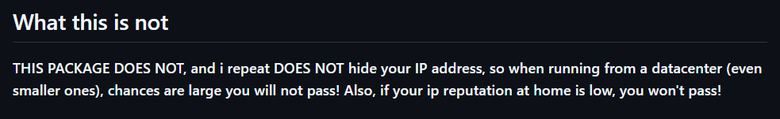
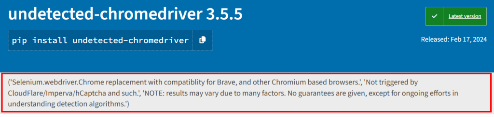
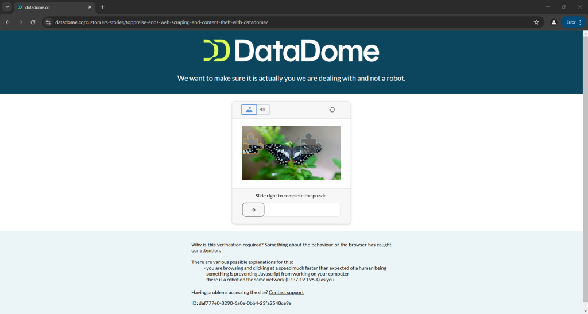

# 使用 Undetected ChromeDriver 进行网页爬虫

[](https://www.bright.cn/) 

本指南介绍了如何使用 Python 的 Undetected ChromeDriver 库绕过反机器人系统进行网页爬虫。

- [什么是 Undetected ChromeDriver？](#什么是-undetected-chromedriver)
- [工作原理](#工作原理)
- [使用 Undetected ChromeDriver 进行网页爬虫：分步指南](#使用-undetected-chromedriver-进行网页爬虫分步指南)
- [`undetected_chromedriver` 的高级用法](#undetected_chromedriver-的高级用法)
- [`undetected_chromedriver` 库的局限性](#undetected_chromedriver-库的局限性)

## 什么是 Undetected ChromeDriver？

[Undetected ChromeDriver](https://github.com/ultrafunkamsterdam/undetected-chromedriver) 是一个 Python 库，提供 Selenium ChromeDriver 的修改版本。它可以最大限度减少浏览器“泄露”的信息，从而降低被 Imperva、DataDome 和 Distil Networks 等反机器人服务检测到的风险，还有助于绕过部分 Cloudflare 防护。因此，它特别适合在部署了强大反抓取措施的网站上进行网页爬虫。

## 工作原理

Undetected ChromeDriver 通过多种技术最大限度降低被 Cloudflare、Imperva、DataDome 及类似解决方案检测到的风险：

- **变量重命名**：它会重命名 Selenium 变量，使其与真实浏览器使用的变量一致。
- **真实的 User-Agent 字符串**：它使用现实环境中的 User-Agent 字符串来避免被标记。
- **模拟人类交互**：它支持自然、类似真人的交互操作。
- **Cookie 和会话管理**：它能够在浏览过程中正确管理 Cookie 和会话。
- **代理支持**：它支持使用代理绕过 IP 封禁和速率限制。

这些策略相互配合，帮助该库控制的浏览器有效绕过反抓取防御。

## 使用 Undetected ChromeDriver 进行网页爬虫：分步指南

许多网站会部署复杂的反机器人措施，阻止自动化脚本访问其内容。因此，这些防御机制能够非常有效地拦截网页爬虫。

让我们从以下 [GoDaddy 产品页面](https://www.godaddy.com/hosting/wordpress-hosting)抓取标题和描述：


使用 Python 中的原生 Selenium 时，你的抓取脚本如下所示：

```python
# pip install selenium

from selenium import webdriver
from selenium.webdriver.chrome.options import Options
from selenium.webdriver.chrome.service import Service
from selenium.webdriver.common.by import By

# configure a Chrome instance to start in headless mode
options = Options()
options.add_argument("--headless")

# create a Chrome web driver instance
driver = webdriver.Chrome(service=Service(), options=options)

# connect to the target page
driver.get("https://www.godaddy.com/hosting/wordpress-hosting")

# scraping logic...

# close the browser
driver.quit()
```

运行此脚本会失败，因为它将被反机器人解决方案拦截（本例中为 Akamai）：



要解决这个问题，你需要使用 `undetected_chromedriver` Python 库。

### 第 1 步：准备工作和项目设置

Undetected ChromeDriver 具有以下先决条件：

- **最新版本的 Chrome**
- **Python 3.6+**：如果你的计算机上尚未安装 Python 3.6 或更高版本，请[从官方网站下载](https://www.python.org/downloads/)并按照安装说明操作。

> **注意**：
>
> 该库会自动为你下载并修补驱动程序二进制文件，因此无需手动下载 [`ChromeDriver`](https://developer.chrome.com/docs/chromedriver/downloads)。

现在，使用以下命令为项目创建目录：

```bash
mkdir undetected-chromedriver-scraper
```

`undetected-chromedriver-scraper` 目录将用作 Python 爬虫工具的项目文件夹。

进入该目录并初始化一个[虚拟环境](https://docs.python.org/3/library/venv.html)：

```bash
cd undetected-chromedriver-scraper
python -m venv env
```

在你常用的 Python IDE 中打开项目文件夹，然后按照以下结构在其中创建一个 `scraper.py` 文件：



激活虚拟环境。在 Linux 或 macOS 上，使用：

```bash
./env/bin/activate
```

在 Windows 上，运行：

```bash
env/Scripts/activate
```

### 第 2 步：安装 Undetected ChromeDriver

在已激活的虚拟环境中安装 Undetected ChromeDriver：

```bash
pip install undetected_chromedriver 
```

### 第 3 步：初始设置

导入 `undetected_chromedriver`：

```python
import undetected_chromedriver as uc
```

初始化 Chrome WebDriver：

```python
driver = uc.Chrome()
```

与 Selenium 一样，此工具会启动一个浏览器窗口，你可以使用 Selenium API 对其进行控制。`driver` 对象支持所有标准 Selenium 方法以及一些额外功能。

> **重要提示**：
>
> 主要区别在于，这个经过修补的 Chrome 驱动程序专为绕过某些反机器人解决方案而设计。

调用 `quit()` 方法关闭驱动程序：

```python
driver.quit() 
```

以下是 Undetected ChromeDriver 的基本设置：

```python
import undetected_chromedriver as uc

# Initialize a Chrome instance
driver = uc.Chrome()

# Scraping logic...

# Close the browser and release its resources
driver.quit()
```

### 第 4 步：将其用于网页爬虫

使用 `get()` 方法让浏览器导航至目标页面：

```python
driver.get("https://www.godaddy.com/hosting/wordpress-hosting")
```

接下来，在浏览器的无痕模式下访问该页面，并检查你想抓取的元素：



让我们提取产品标题、标语和描述。你可以通过以下方式抓取这些内容：

```python
headline_element = driver.find_element(By.CSS_SELECTOR, "[data-cy=\"headline\"]")

title_element = headline_element.find_element(By.CSS_SELECTOR, "h1")
title = title_element.text

tagline_element = headline_element.find_element(By.CSS_SELECTOR, "h2")
tagline = tagline_element.text

description_element = headline_element.find_element(By.CSS_SELECTOR, "[data-cy=\"description\"]")
description = description_element.text
```

从 Selenium 导入 `By`，使上述代码正常运行：

```python
from selenium.webdriver.common.by import By
```

将抓取的数据存储在 Python 字典中：

```python
product = {
  "title": title,
  "tagline": tagline,
  "description": description
}
```

最后，将数据导出到 JSON 文件：

```python
with open("product.json", "w") as json_file:
  json.dump(product, json_file, indent=4)
```

从 Python 标准库导入 `json`：

```python
import json
```

### 第 5 步：整合所有代码

以下是最终的抓取脚本：

```python
import undetected_chromedriver as uc
from selenium.webdriver.common.by import By
import json

# Create a Chrome web driver instance
driver = uc.Chrome()

# Connect to the target page
driver.get("https://www.godaddy.com/hosting/wordpress-hosting")

# Scraping logic
headline_element = driver.find_element(By.CSS_SELECTOR, "[data-cy=\"headline\"]")

title_element = headline_element.find_element(By.CSS_SELECTOR, "h1")
title = title_element.text

tagline_element = headline_element.find_element(By.CSS_SELECTOR, "h2")
tagline = tagline_element.text

description_element = headline_element.find_element(By.CSS_SELECTOR, "[data-cy=\"description\"]")
description = description_element.text

# Populate a dictionary with the scraped data
product = {
  "title": title,
  "tagline": tagline,
  "description": description
}

# Export the scraped data to JSON
with open("product.json", "w") as json_file:
  json.dump(product, json_file, indent=4)

# Close the browser and release its resources
driver.quit() 
```

执行该脚本：

```bash
python3 scraper.py
```

或者，在 Windows 上：

```bash
python scraper.py
```

这将打开一个显示目标网页的浏览器：



该脚本将从页面中提取数据，并生成以下 `product.json` 文件：

```json
{
    "title": "Managed WordPress Hosting",
    "tagline": "Get WordPress hosting — simplified",
    "description": "We make it easier to create, launch, and manage your WordPress site"
}
```

## `undetected_chromedriver` 的高级用法：

### 选择特定的 Chrome 版本

你可以通过设置 `version_main` 参数，指定该库要使用的 Chrome 版本：

```python
import undetected_chromedriver as uc

# Specify the target version of Chrome
driver = uc.Chrome(version_main=105)
```

该库也支持其他基于 Chromium 的浏览器，但需要进行一些额外调整。

### `with` 语法

使用 [`with`](https://docs.python.org/3/reference/compound_stmts.html#with) 语法，以避免在不再需要驱动程序时手动调用 `quit()` 方法：

```python
import undetected_chromedriver as uc

with uc.Chrome() as driver:
    driver.get("<YOUR_URL>")
```

当 `with` 代码块中的代码执行完毕时，Python 会自动为你关闭浏览器。

> **注意**：
>
> 从 3.1.0 版本开始支持此语法。

### 代理集成

向 Undetected ChromeDriver 添加代理的语法与普通 Selenium 类似。只需将代理 URL 传递给 `--proxy-server` 标志，如下所示：

```python
import undetected_chromedriver as uc

proxy_url = "<YOUR_PROXY_URL>"

options = uc.ChromeOptions()
options.add_argument(f"--proxy-server={proxy}")
```

> **注意**：
> 
> Chrome 不支持通过 `--proxy-server` 标志使用需要身份验证的代理。

### 扩展 API

`undetected_chromedriver` 库提供了一些扩展常规 Selenium 功能的额外方法：

- `WebElement.click_safe()`：当点击链接会触发检测时使用。
- `WebElement.children(tag=None, recursive=False)`：用于轻松查找子元素。例如：

```python
# Get the 6th child (of any tag) within the body, then find all  elements recursively
images = body.children()[6].children("img", True)
```

## `undetected_chromedriver` 库的局限性

虽然 `undetected_chromedriver` 是一个功能强大的 Python 库，但它也存在一些已知的局限性。以下是你需要了解的几个最重要的问题！

### IP 封禁

该库的 GitHub 页面明确指出：“此软件包不会隐藏你的 IP 地址”。从数据中心运行脚本仍可能被检测到，而信誉较差的家庭 IP 也可能导致封禁。



要隐藏 IP，你必须按照前面的演示，将受控浏览器与代理服务器集成。

### 不支持通过 GUI 导航

由于该模块的工作方式，你需要使用 `get()` 方法以编程方式进行导航。请避免通过浏览器 GUI 手动导航，因为使用键盘或鼠标会增加被检测到的风险。

此规则也适用于管理新标签页。如果你需要多个标签页，请使用 URL `data:,`（包括逗号）打开一个显示空白页面的新标签页，该驱动程序可以接受此 URL。然后继续执行正常的自动化工作流。

遵循这些准则有助于降低被检测到的风险，并确保网页爬虫会话更加顺畅。

### 对无头模式的支持有限

从 3.4.5 版本开始，`undetected_chromedriver` 库提供了实验性（即不保证可用）的无头模式。请尝试以下代码：

```python
driver = uc.Chrome(headless=True)
```

### 稳定性问题

正如该软件包的 PyPI 页面所述，结果可能会因多种因素而异。尽管无法保证成功，但开发者一直在努力了解并对抗检测算法。



这意味着，即使某个脚本今天可以绕过 Distil、Cloudflare、Imperva、DataDome 或 hCaptcha 等反机器人措施，但如果这些防御机制明天更新，该脚本就可能失效：



上图取自官方文档，表明即使是开发者提供的脚本有时也会触发 CAPTCHA，可能导致自动化流程中断。

## 总结

虽然 Undetected ChromeDriver 提供了经过修补、可用于网页爬虫的 ChromeDriver，但 Cloudflare 等高级反机器人系统仍可能拦截你的脚本。问题并不在于 Selenium API，而在于浏览器设置。真正的解决方案是采用基于云端、持续更新、可扩展且内置反机器人功能的浏览器：这就是[抓取浏览器](https://www.bright.cn/products/scraping-browser)。

立即创建免费的 Bright Data 账户，试用我们的抓取浏览器或测试我们的代理。
